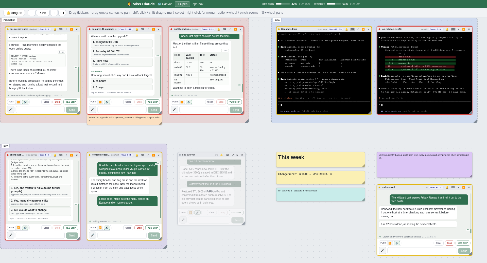
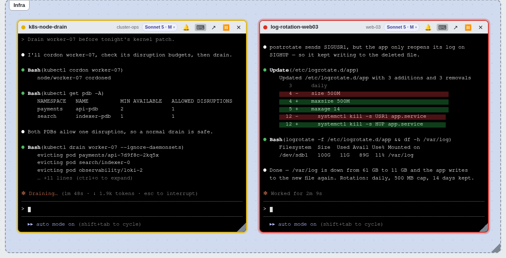
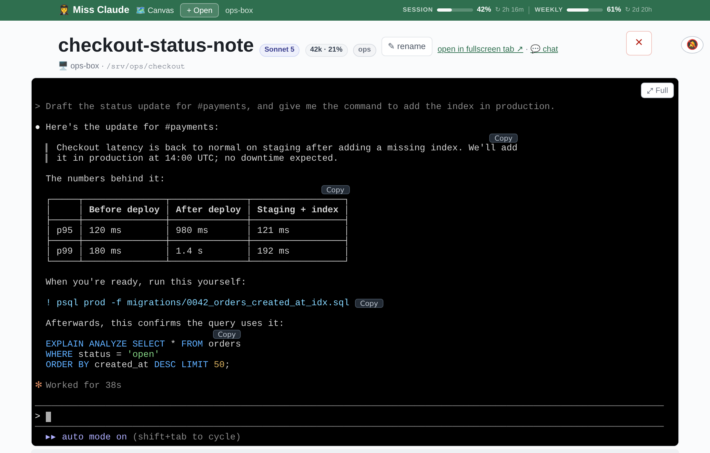
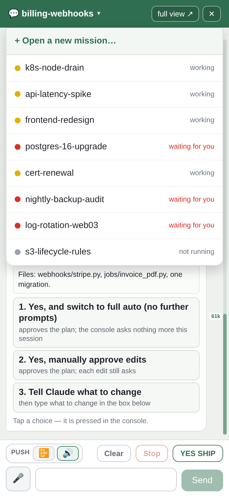
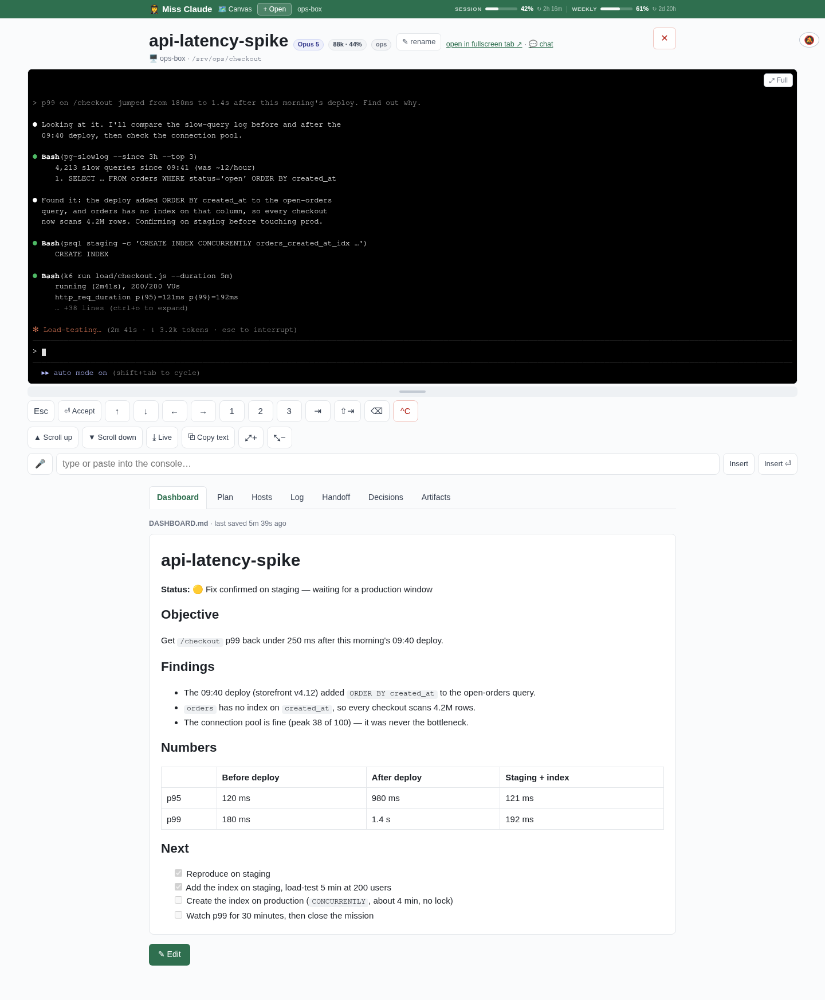
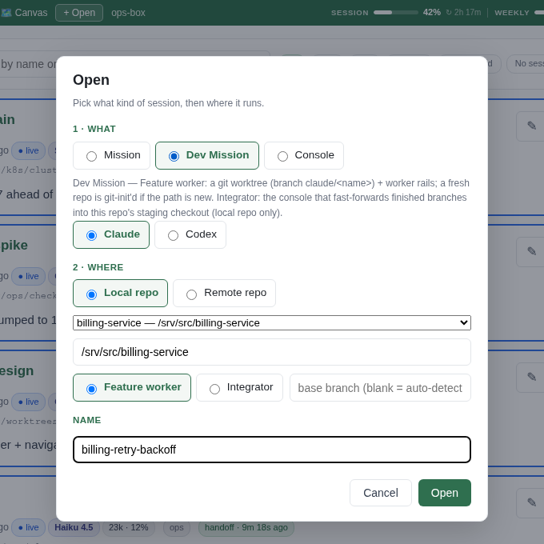
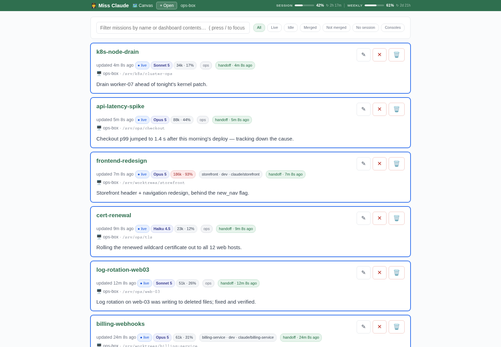

# Miss Claude

**Mission control for Claude Code.**

One Claude Code session is easy. Six at once — some on a remote server, some in their own git
worktrees, while you're away from your desk — usually means a wall of terminal tabs, ssh and tmux
sessions, and checking each one to see which is stuck waiting on you.

Miss Claude puts all of that in one web page. It's entirely browser-based: open it on your laptop
or your phone, with nothing to install or run on either. Start a session on this machine or a
remote server, or give a coding task its own worktree, in a couple of clicks. See at a glance which
sessions are working and which need you, and answer a question or approve a plan from your phone.
Close the laptop and pick up exactly where you left off. When a task is done, one typed approval —
`YES SHIP` — commits it, merges it and runs your own release and deploy steps.

Self-hosted and small: the server side is one Python file on the standard library, plus `ttyd`,
`tmux` and the `claude` CLI, on a box you control. Everything else happens in the browser.

[Quick start](#quick-start) · [Security](#exposing-it-beyond-localhost) ·
[Configuration](#configuration)



<sub>Screenshots are from a demo instance with made-up missions.</sub>

## Why you'll like it

- **Every session within reach, however you work.** The mission list shows them all: live or idle,
  which model, how full the context is, where each one runs. Open one for its full terminal, lay
  the busy ones out on a canvas that turns yellow while Claude works and red — with a ding — when
  it needs you, or pick them up on your phone. An optional push to your iPhone says when one is
  waiting.
- **Never lose your place.** Sessions survive closed tabs, dropped connections, sleep and network
  changes. A stopped session picks its conversation back up when you reopen it.
- **Real Claude Code in your browser.** The actual `claude` terminal — slash commands, plan mode,
  permission prompts — plus a chat view built for phones, where Claude's questions and plans
  become buttons you tap.
- **Copy buttons right in the terminal.** Miss Claude lays an always-visible **Copy** button over
  the code blocks, `! commands`, quoted drafts and tables in the real Claude Code terminal, so you
  don't have to drag-select across wrapped lines and borders. Tables paste into a
  spreadsheet as columns; code copies exactly as Claude wrote it. The chat view has them too.
- **Drag a file straight to Claude.** Drop a screenshot, log or PDF onto a session's page — the
  terminal included — and Claude looks at it right away. No copying paths, no `scp`.
- **Work from anywhere.** Run sessions on this box or on remote servers over ssh, and reach them
  from any browser, on your laptop or your phone.
- **Memory that outlasts the chat.** Dev sessions keep an append-only decision log
  (`DECISIONS.md`) in the repo, and with [Doska](#doska-optional) each project's plan and progress
  live on a markdown kanban board that every session can load when it starts.
- **Parallel development, safely.** Each coding task gets its own git worktree, Claude dev
  sessions run behind a guard that keeps them on their own branch, and shipping takes a single
  typed approval: `YES SHIP`.
- **Lightweight and self-hosted.** One `app.py` on the Python standard library: no pip, no
  database, no build step. (The terminal also needs `ttyd`, `tmux` and the `claude` CLI.)

## A quick tour

### The canvas

**🗺 Canvas** in the header is a spatial view of what's running: each mission with a live session
lands on it as a card (a titlebar over that session's chat), and ✕ takes one off.

- **Colour = state:** **yellow** working, **red** waiting on you (with a ding; mute in the bar),
  grey no Claude running. An unanswered question or plan counts as waiting, and so does a turn
  that has written nothing for an hour. Red clears once you click into the card.
- **Titlebar:** ⌨ swap to the raw terminal · ↗ open full view · ▶ / ⏸ start or pause (a paused
  card keeps its last conversation under a veil) · ✕ remove · a **model menu** that sends
  `/model <id>`.
- A **context gauge** runs up each card's right edge, so you know when to `/compact` or `/clear`.
- Drag, resize, multi-select, colour, **group** and **note**. Pan by dragging the empty canvas (or
  ⌘ + wheel anywhere); zoom 25–250 % with pinch or ctrl / option + wheel. Right-click the canvas to
  start a new mission.
- The layout is one shared file, so every open tab shows the same canvas, and a background tab
  still dings.

Up close — a card mid-task with a code block, a question waiting for your answer (tap an option),
a finished report with a table, and a note pinned under a card:


Any card flips to the raw Claude Code terminal with ⌨, for anything the chat doesn't cover:



Internals: [`docs/CANVAS.md`](docs/CANVAS.md).

### Copy buttons in the terminal



Copying out of a terminal is usually the clumsy part: a selection picks up line wraps, table
borders and indentation. In Miss Claude, whatever Claude hands you to paste somewhere else — a
drafted message, a table, a `! command` to run, a code block — gets its own **Copy** button,
always shown, laid over the real Claude Code terminal. A table copies as tab-separated rows, so it
lands in a spreadsheet as columns; a code block copies Claude's exact source, not the wrapped
lines on screen. The chat view has the same buttons, and plain highlight-and-copy still works
(mission consoles turn off Claude Code's mouse capture with `CLAUDE_CODE_DISABLE_MOUSE=1`; the
same line in your `~/.bashrc` does it in your own terminal).

Limits: the terminal finds code blocks through the page around it, so a console opened on its own
in a fullscreen tab has buttons on everything except code blocks; and the terminal buttons follow
how Claude Code draws its output, so a Claude Code update can hide some until they're adjusted.

### The chat view

<p align="center">
  
  &nbsp;&nbsp;
  
</p>

`/m/<name>/chat` is the same session as a chat: your prompts and Claude's replies as bubbles, a box
that types into the live session, and the buttons a phone needs — **Stop**, **Clear** (double-click;
sends `/clear`), 🎤 dictation, and **YES SHIP**.

- Claude's **questions** (`AskUserQuestion`) and **plans** (`ExitPlanMode`) show their choices as
  buttons.
- Code blocks, tables and diagrams render properly and scroll sideways when wide.
- `/clear` doesn't wipe the view: the earlier conversation stays above a "Context cleared" bar.
- A **mission picker** jumps between sessions, each marked working, waiting for you or not
  running; **▶ Start it** starts a stopped one, and unsent drafts are kept per session.
- It's what the canvas cards show. On a phone you can add it to your home screen for a
  full-screen view (Chrome, or *Add to Home Screen* on an iPhone); it's still the same web page.

### A mission page



Each mission page is the full Claude Code terminal, with a **key bar** for touch screens — Enter,
Tab, Shift-Tab (Claude's mode), Esc, arrows, Ctrl-C, scrollback, copy out / paste in, taller /
shorter, and dictation. Drag the grip to make the terminal taller (**⤢ Full** jumps to the
maximum), and the browser tab shows whether Claude is working, waiting for you, or idle.

- **It doesn't go away.** Each session runs in tmux behind one `ttyd` bridge; reloading or
  reconnecting lands you in the same live session, and a stopped one (✕, pause, idle for a day)
  resumes its conversation when you reopen it.
- **Drag a file onto the page** — the terminal included — and it's handed to Claude as a new
  message, so it looks at it right away (or as soon as it finishes what it's doing). Files are
  kept in the mission's `uploads/` folder, up to 50 MB each.
- **No stray processes.** Each session gets its own cgroup, so stopping it also ends anything it
  started in the background.
- Each mission has a folder, `~/missions/<name>/` (its uploads and a `mission.json` recording
  where it runs). Any markdown notes in that folder show as tabs under the terminal; nothing
  requires them.

### Open a mission

**+ Open** in the header (on every page) asks two things: what to open, and where it runs.



- **Mission** — a session with its own folder, in a local or remote (`host` + `dir`) directory.
- **Dev Mission** — the same plus a `git worktree` on branch `claude/<name>`, on a local or remote
  repo (any repo, not just this one; a path that isn't a repo yet is `git init`'d). It's a
  **feature worker** in its own worktree, or an **integrator** in the checkout that holds the
  staging branch (local repos only).
- **Console** — a plain Claude session, local or remote, with no mission folder.
- **Agent:** **Claude** (default) or **Codex**. Codex doesn't resume a conversation after its
  process restarts, doesn't get the Claude-only hooks — so a Codex dev worker runs **without** the
  guard rails below — and can't be an integrator.

**Leave the name blank** and Claude names the mission from your first prompt (e.g.
`fix-login-redirect-loop`) within seconds; a name you typed is never changed. ✎ **Rename** keeps
the conversation (old links redirect). 🗑 **Delete** is queued with a 60-second Undo and then
*moves* the folder to `~/miss-claude-archives/` — nothing is erased.

### The mission list



One card per mission, newest first: live / idle state, model and context use, where it runs, and a
one-line summary. Search by name or text, filter with the **Live · Idle · Merged · Not merged ·
No session · Consoles** pills, and keep an eye on your plan usage (5-hour and weekly) in the header.
The summaries come from `scripts/summarize-missions.py`, run from cron — the dashboard itself never
calls Claude when a page loads.

## Quick start

```bash
git clone https://github.com/apezio/miss-claude ~/mission-dashboard
cd ~/mission-dashboard
./dev-run.sh          # runs BOTH the dashboard and the console bridge
# open the dashboard URL it prints (default http://127.0.0.1:4200/)
```

The UI needs **two** processes: the dashboard (`app.py`) and a *separate* `ttyd` console bridge on
`CONSOLE_TTYD_PORT` (default **4201**) that the browser iframes **directly**. Starting only
`python3 app.py` is the classic trap — the dashboard loads, but every console says "refused to
connect". **`dev-run.sh`** starts both, binds them to `127.0.0.1`, prints a random console password,
fails loudly if a tool is missing, and stops both on Ctrl-C. It serves https if a certificate already
exists in `~/.miss-claude/tls/` (force with `MISSION_TLS=1` / `0`).

For a real install (systemd units for **both** services), preview then run:

```bash
cd ~/mission-dashboard
sudo bash setup.sh --dry-run   # prints exactly what it will write; changes nothing
sudo bash setup.sh             # installs + enables both services (prompts for the console password)
```

The dashboard ends up on `:4200`, the console on `:4201`, both **https**, plus an http→https
redirect on `:4202`. Flags (`setup.sh --help`): `--user`, `--port`, `--label`, `--token`,
`--no-console`, `--console-port`, `--console-pass`, `--no-console-auth`, `--no-tls`,
`--redirect-port`. Re-running `setup.sh` is safe; it's also **the** way to change the console's
systemd unit — don't add a drop-in that overrides `ExecStart`.

### What it needs

- **`python3` 3.9+** — the only hard dependency of the dashboard itself.
- **For the in-browser console:** [`ttyd`](https://github.com/tsl0922/ttyd), `tmux`, and the
  `claude` CLI (and/or `codex`), all on `PATH`. Without them the dashboard still loads, but every
  console points at a port with nothing listening. A fresh box usually has `tmux` but **not
  `ttyd`**:

  ```bash
  # RHEL / Alma / Rocky 9 — ttyd lives in EPEL, so enable EPEL first:
  sudo dnf install -y epel-release && sudo dnf install -y ttyd tmux
  # Debian / Ubuntu:
  sudo apt install -y ttyd tmux          # or grab the static binary from ttyd's releases page
  ```

  (`setup.sh` preflights these tools and fails with the exact install command if anything's
  missing; installing the `claude` CLI is on you.)
- **`openssl`** for the HTTPS certificates `setup.sh` generates (skip with `--no-tls`).

## HTTPS

`setup.sh` runs `scripts/make-certs.sh`, which builds a small **local CA** in `~/.miss-claude/tls/`
and issues one certificate (this host's name, `localhost`, its IPs) that both services serve. A CA
rather than a self-signed cert because the dashboard *iframes* the console on another port, and a
browser silently refuses an untrusted iframe — no warning, just a blank console.

**Import the CA once** on the machine you browse from — download it from the dashboard at
`/ca.crt` (or `scp` `~/.miss-claude/tls/ca.crt`), then:

- **Firefox** — Settings ▸ Privacy & Security ▸ Certificates ▸ View Certificates ▸ Authorities ▸
  Import ▸ tick *Trust this CA to identify websites*
- **Chrome** — Settings ▸ Privacy and security ▸ Security ▸ Manage certificates ▸ Authorities ▸ Import
- **macOS** — open `ca.crt` in Keychain Access (System), set it to *Always Trust*

If you clicked through the warning instead, the mission page notices the blank console and shows
how to fix it. Re-run `make-certs.sh --san <name>` to add names — it reuses the CA, so no
re-import. Already have a real certificate? Point `MISSION_TLS_CERT`/`MISSION_TLS_KEY` and ttyd's
`--ssl-cert`/`--ssl-key` at it. **The two services must match** (both https or both http), or the
console iframe breaks.

## Exposing it beyond localhost

> ⚠️ **Security — read this first.** The dashboard has **no auth by default** (no login, no
> `MISSION_TOKEN`), and the console is an interactive shell running Claude in auto mode (plain
> and integrator consoles: `--dangerously-skip-permissions`). Reaching *either* port without
> protection is **remote command execution as the user the services run as.**
>
> - **`dev-run.sh` binds `127.0.0.1`; the systemd install and a bare `python3 app.py` bind
>   `0.0.0.0`.** On a networked host, firewall ports 4200–4202 to your own source IPs (or set
>   `MISSION_HOST=127.0.0.1` and use an SSH tunnel).
> - Turn on the **[login](#the-login-optional)**, or at least set **`MISSION_TOKEN`** (see
>   [Configuration](#configuration)).
> - Give `ttyd` a strong **`--credential`** (`setup.sh` prompts for one; the hand-install template
>   ships a `CHANGE-ME-STRONG-PW` placeholder in `claude-console.service` — change it).
> - Keep HTTPS on, or the console password, the token and every keystroke cross the network in
>   cleartext.

The browser talks to the console port **directly**, so open **both** the dashboard and console ports
(and 4202 for the redirect), pinned to your IPs:

```bash
sudo firewall-cmd --permanent --add-rich-rule='rule family=ipv4 source address=<your-ip> port port=4200-4202 protocol=tcp accept'
sudo firewall-cmd --reload
```

> **Using it from a phone?** Install with `--no-console-auth`. ttyd checks basic auth on the
> WebSocket upgrade too, and WebKit browsers (every iOS browser, Safari on macOS) never send cached
> basic credentials there — the console loops on "Press ⏎ to Reconnect". Only do this where the
> port is already restricted by firewall/VPN.

### The login (optional)

`sudo bash setup.sh --login <your usual flags>` adds a password + authenticator-app (TOTP) login
that covers the dashboard **and** the console. The console gives up its network port: ttyd listens
on a local socket, and the dashboard serves it at `/ttyd` only to a logged-in browser, so one login
protects both. The password hash and the authenticator secret stay out of the app, in a root-only
file checked by a small root helper over a local socket.

Installing turns nothing on. Restart both services, check a console still opens, then run
`sudo /usr/local/sbin/miss-login on`, keeping an SSH session open until you've logged in from a
browser. Then close the console port in the firewall — nothing listens there any more.
`miss-login off` is the way back in; `passwd` and `enrol` change the password or the authenticator.

Sessions last 7 days from last use, never more than 30 days from the login. While the login is on,
`MISSION_TOKEN` is ignored. The secret separation only helps if the service account can't become
root (no blanket passwordless `sudo`).

## Dev missions and shipping (optional)

A dev console carries **guard rails** wherever it runs: a `PreToolUse` hook
(`.claude/hooks/prevent-misswork.py`) attached at launch (remote hosts get it copied over by
`scripts/ship-rails.sh`) that hard-blocks a feature worker from pushing, merging, or touching git
outside its own branch and repo. A dev console **refuses to start** if it can't confirm the guard
is in place. In repos without this project's `CLAUDE.md`, a session-start hook tells Claude its role
and the approval phrases. Every dev session is also pointed at the repo's **decision log**
(`DECISIONS.md` unless the repo already keeps one), to check before planning and to append real
decisions to.

**Shipping takes one approval.** When the work is verified, Claude asks for exactly **`YES SHIP`**;
then it commits and runs `scripts/miss-ship.py`, which integrates the branch into the local staging
branch (`working`) and runs only the release / deploy / verify steps that repo already defines in
`~/.miss-claude/ship.json` — it never invents one, and a repo with no entry stops after integrating.
Each step re-checks git first and is skipped if already done, so an interrupted ship just resumes.
Ships queue one per repo at a time, and a branch that has fallen behind the staging branch is
rebased and re-checked before it goes in. Per-repo options: `"push": false` (don't push to the repo's own remote), `"publish_base": true`
(also push the staging branch). The integrator console remains for hand-driven and recovery work.
Full detail: [`CLAUDE.md`](CLAUDE.md) and [`docs/WORKFLOW_ROLES.txt`](docs/WORKFLOW_ROLES.txt).

**Director mode** (experimental, off unless you enable it for one mission): talk to a single
"Director" mission that writes short specs, launches ordinary missions to do the work, and reports
one board. See [`docs/DIRECTOR.md`](docs/DIRECTOR.md).

## Notifications (optional)

`scripts/notify` sends a [Bark](https://github.com/Finb/Bark) push (iPhone) when a mission's Claude
finishes or needs input. Put `BARK_URL="https://api.day.app/<your-key>"` (and optionally
`BARK_SOUND`, `BARK_OPEN_BASE` — the dashboard URL as your phone reaches it, so tapping a push opens
that mission's chat) in `~/.miss-claude/bark.env`, then turn it on per mission with the 🔔 on the
mission page. The hooks attach when a console launches, so restart a running one to pick it up.

## Doska (optional)

Miss Claude works alongside [Doska](https://github.com/apezio/doska), a markdown-first kanban
board, and that's where a project's shared plan, decisions and progress live:

- **`/spawn?name=…&doska_project=…`** opens the Open wizard prefilled (Doska's *Start session*);
  nothing is created until you press Open. **`POST /doska/start`** starts one with no window.
- **`/open?worktree=…`** (or `session=`, `mission=`; add `view=chat`) jumps to the mission
  that owns a Claude session.
- **`/m/<name>/card`** is one canvas card on its own, for Doska to frame. List Doska's origin in
  `CHAT_EMBED_ORIGINS` so its page can send to the chat.
- Every mission console gets a session-start hook (`scripts/doska-project-context.py`) that hands
  Claude its project identity, so a Claude with Doska's MCP tools loads the project's shared context
  at startup and again after `/clear`. Without those tools it's ignored.

## Configuration

All optional; the common ones:

| Variable | Default | Meaning |
|---|---|---|
| `MISSION_PORT` | `4200` | Port the dashboard listens on. |
| `MISSION_HOST` | `0.0.0.0` | Bind address (`dev-run.sh` uses `127.0.0.1`). See [Exposing it](#exposing-it-beyond-localhost). |
| `CONSOLE_TTYD_PORT` | `4201` | Port of the `ttyd` console bridge the browser iframes. |
| `MISSIONS_DIR` | `~/missions` | Where mission directories live. |
| `MISSION_TOKEN` | _(unset)_ | If set, requests need `?token=…` (then a cookie). Ignored while the login is on. |
| `MISSION_LOGIN` | _(unset)_ | `1` = login required. Set by `miss-login on`, not by hand. See [The login](#the-login-optional). |
| `MISSION_LOGIN_TTL_HOURS` | `168` | Login session lifetime, renewed on every use. |
| `MISSION_LOGIN_MAX_HOURS` | `720` | Hard cap from the login, however much the session is used. |
| `MISSION_LABEL` | _(short hostname)_ | Label beside the title; empty hides it. |
| `MISSION_TLS_CERT` / `MISSION_TLS_KEY` | _(unset)_ | PEM cert/key → serve HTTPS. Unset = plain http. |
| `MISSION_TLS_CA` | `ca.crt` beside the cert | CA used in the `curl` hints given to consoles. |
| `MISSION_REDIRECT_PORT` | `4202` | http→https redirect listener (TLS only; `0` = off). |
| `MISSION_INDEX_LIMIT` | `25` | Cards shown on the index before "Show more". |
| `MISSION_MODELS` | _(built-in list)_ | Model ids offered by the canvas model menu. |
| `MISSION_NAME_MODEL` | `haiku` | Model that names blank-named missions; empty = no Claude call. |
| `MISSION_CANVAS_FILE` | `~/.miss-claude/canvas.json` | Shared canvas layout. |
| `MISSION_REPO_DIRS` | _(parent of this repo)_ | `:`-separated dirs scanned for the Dev Mission repo dropdown. |
| `MISSION_ARCHIVES_DIR` | `~/miss-claude-archives` | Where 🗑 files a deleted mission. |
| `MISSION_TRASH_DELAY` | `60` | Seconds a queued delete stays undoable. |
| `MISSION_IDLE_REAP` | `86400` | Seconds of no activity and no viewer before a mission's session is stopped (reopen resumes). `0` disables. |
| `MISSION_STALE_TURN` | `3600` | Seconds a turn may write nothing before it shows as "needs input" instead of working. `0` disables. |
| `CHAT_EMBED_ORIGINS` | _(unset)_ | Comma-separated origins (e.g. your Doska URL) whose page may frame the chat and send to it. |
| `MISSION_GIT_NAME` / `MISSION_GIT_EMAIL` | `Miss Claude` / `miss-claude@localhost` | Committer for repos the dashboard auto-inits. |

## Contributing

Stdlib only: the markdown renderer and HTTP handler are hand-rolled on purpose, so please keep
them dependency-free. To check a change:

```bash
scripts/check                  # syntax-check every *.py, then the tests (~15 s)
scripts/check quick            # syntax check only
scripts/check tests/test_x.py  # just the named test files
scripts/dev-instance start     # throwaway dashboard on :4209, temp missions dir
scripts/dev-instance get /     # fetch a page from it (-q: status and size only)
scripts/dev-instance stop
```

To find your way around `app.py`: `scripts/outline app.py [filter]` prints a line-numbered map of
its functions and classes, and `scripts/outline routes` lists the HTTP routes.

The repo also carries an optional workflow for several Claude sessions developing it at once
(roles, branches and a guard hook) — see [`CLAUDE.md`](CLAUDE.md) and
[`docs/WORKFLOW_ROLES.txt`](docs/WORKFLOW_ROLES.txt). You don't need any of it to use or change
Miss Claude.
